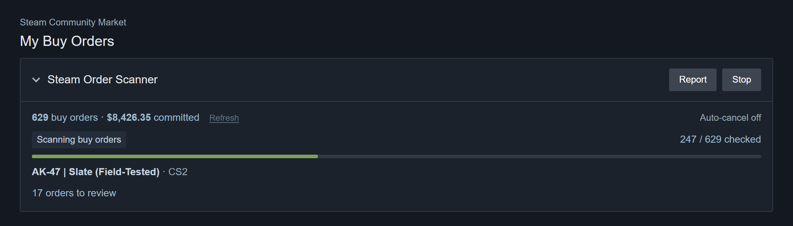
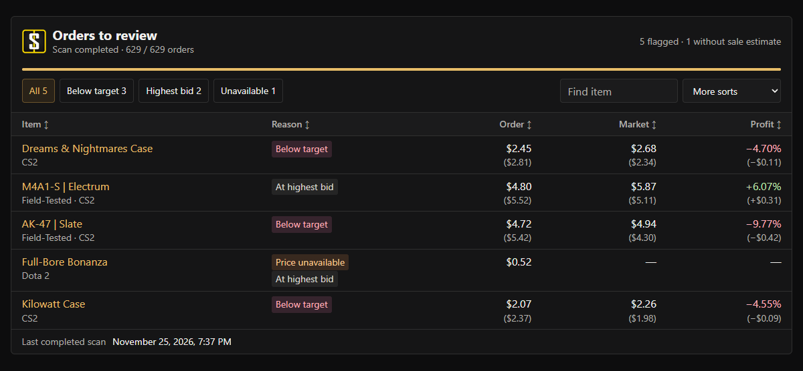
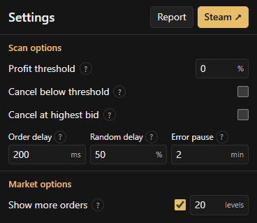

  

<h1 align="center">Steam Order Scanner</h1>

  

  <a href="https://github.com/auwaho/steam-order-scanner/releases/latest">Download from GitHub</a>

I built Steam Order Scanner to make checking Steam Market buy orders a little less tedious. It helps you see which bids are worth another look and what you could get back after fees.

## Getting started

1. Sign in to Steam in Chrome and open your buy orders. [My Buy Orders](https://steamcommunity.com/market/buyorders)
2. Hit **Start scan**. The panel checks all your active buy orders, so you can keep the page open and let it run.
3. Open **Report** to see orders at the highest bid or below your profit target. You can search, filter, and sort the results, and come back to the last completed report later.

The last item you open stays highlighted in your report tab.

The extension popup is where you can set your profit threshold and adjust scan timing. For your first scan, I'd leave both auto-cancel options off and have a look through the results first.

## A few other handy things

- See how much you've committed to buy orders and what you'd need to sell each item for to break even.
- See the totals buyers pay and what you'd receive after fees. [My Active Sell Listings](https://steamcommunity.com/market/activelistings)
- On supported item pages, see the seller's proceeds and how many sold in the last 24 hours.
- Use **Show more orders** to expand the price tables. For items with variants, pick the exact variant and open its buy-order table.

  
More screenshots

## Thanks for using it!

If the extension helped you, a star on GitHub or a kind review is enough to let me know it was worth making. :)
