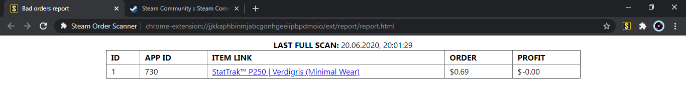

  

<h1 align="center">Steam Order Scanner</h1>

   

<h3 align="center">
  <a href="https://github.com/auwaho/steam-order-scanner/releases/latest">Direct download (GitHub release)</a>
</h3>

<b>Manifest V3</b>: This version targets Chrome Manifest V3 (v2.0.0+). For the legacy Manifest V2 build, download <a href="https://github.com/auwaho/steam-order-scanner/releases/tag/1.7.1">v1.7.1</a>.

**Note: I highly recommend running your first scan with cancellation options disabled ("Cancel first in queue" and "Cancel if below (±%)") to make sure the extension works correctly for you. Compatibility checked with: Steam Inventory Helper, Steam Trader Helper, Augmented Steam.**

## Description

Steam Order Scanner (SORS) is a Chrome extension that helps keep your Steam Community Market buy orders profitable and enhances market pages with useful features.

  
All screenshots

  

#### Extension features

-   **Single scan** on the [Buy Orders page](https://steamcommunity.com/market/buyorders) checks the buy orders loaded on the page. Scroll to load more before starting if needed. Green marks profitable orders, red marks unprofitable orders, and a yellow outline marks orders at the highest bid. Flagged orders appear in the scan report.
-   **Optional auto-cancellation** of risky orders. Controlled by scan options: "Cancel first in queue" and "Cancel if below (±%)".
-   Display **`market_listing_price_without_fee`** under the price of each lot on the item page.
-   Ability to **show more buy and sell orders** on item pages (for commodity items: sales). Quantity is configurable in the popup.
-   Show the **minimum resale price to recover the bid after fees** below each bid on the Buy Orders page.
-   Show **buy-order totals** on the Buy Orders page and **gross and net listing totals** on the [Active Listings page](https://steamcommunity.com/market/activelistings).
-   Show **last 24 hours sold quantity** under the median sales graph on item pages.
-   **Scan report**: view the last full scan report from the extension popup.

## Supporting the project

If you find the project useful, you can help its further development. The best and easiest way to do this is to ⭐ **Star** it. There are also several links inside the 💗 **Sponsor** button if you want to provide additional help. Also, if you have any ideas for the development of the project, you can send them to me at the email address indicated in the profile.
